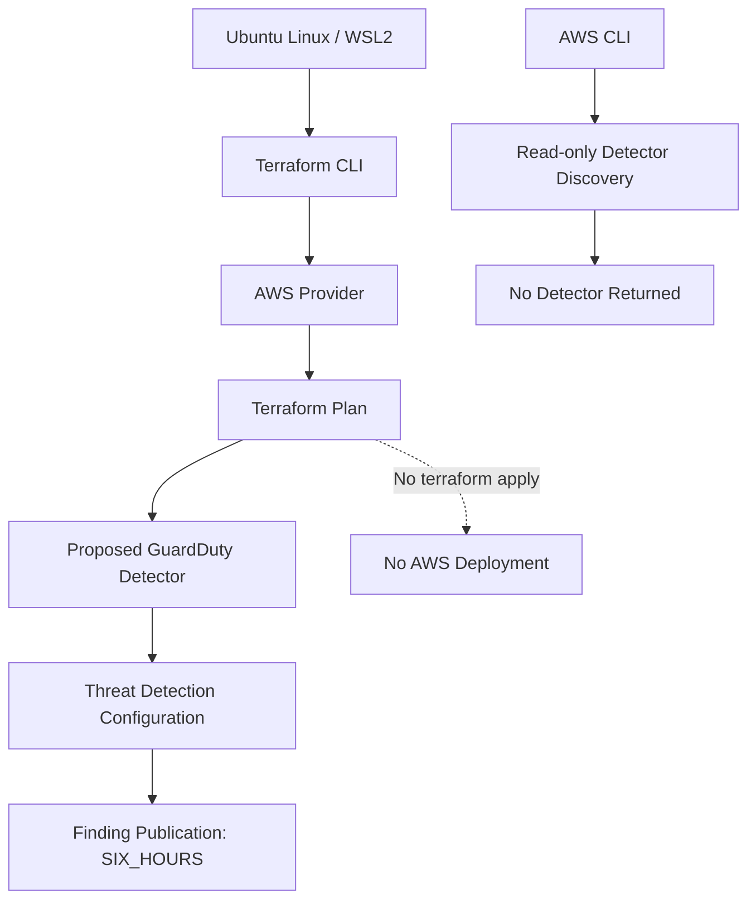
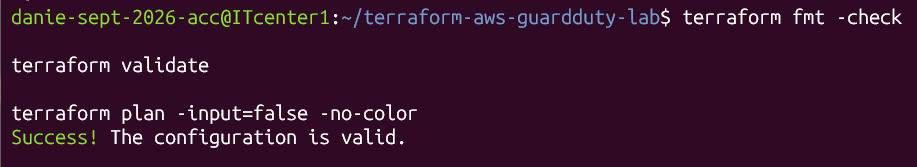

# Amazon GuardDuty Terraform Lab

## Project Overview

This project demonstrates how to define and validate an
Amazon GuardDuty threat-detection configuration using
Terraform and AWS CLI.

The project is PLAN ONLY.

No GuardDuty detector was deployed or enabled.

## Technologies

- Amazon GuardDuty
- AWS CLI
- Terraform
- Ubuntu Linux
- Git and GitHub

## Verified AWS Environment

- AWS Region: us-east-1
- Existing GuardDuty detectors returned: 0
- Terraform version: 1.17.0
- Terraform validation: PASS

## Architecture



## Terraform Files

- providers.tf: AWS provider and region
- main.tf: Proposed GuardDuty detector
- outputs.tf: Proposed detector outputs
- .terraform.lock.hcl: Provider dependency lock file

## Planned Resource

Resource: aws_guardduty_detector.security_lab

Configuration:

- enable = true
- finding_publishing_frequency = SIX_HOURS
- region = us-east-1

## Validation

Commands executed:

```bash
terraform fmt -check
terraform validate
terraform plan -input=false -no-color
```

Observed results:

- Formatting: PASS
- Validation: SUCCESS
- Plan: 1 to add, 0 to change, 0 to destroy

## Validation Evidence

See [Validation Evidence](docs/validation-evidence.md).



## Deployment Status

PLAN ONLY — NOT DEPLOYED.

The proposed GuardDuty detector does not exist
as a result of this Terraform project.

No terraform apply was executed.

## Security and Cost

- GuardDuty may incur charges when enabled.
- Do not run terraform apply without authorization.
- Never commit AWS credentials or private keys.
- Do not publish Terraform state files.
- Review AWS service pricing before deployment.
