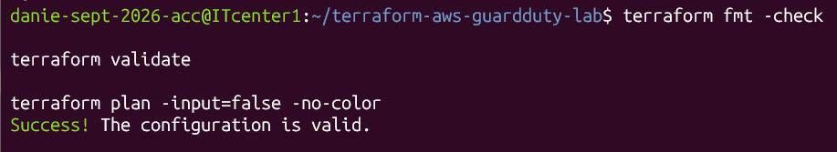

# Amazon GuardDuty Terraform Validation Evidence

## AWS Environment

Region: us-east-1

Account: 774305591665

IAM identity: 3rd-lab-user

## Existing GuardDuty Resources

Command:

aws guardduty list-detectors --region us-east-1

Observed result:

{
  "DetectorIds": []
}

No GuardDuty detectors were returned in this
account and Region.

## Terraform Validation

Terraform version: 1.17.0

terraform fmt -check: PASS

terraform validate: SUCCESS

terraform plan: SUCCESS

## Planned Infrastructure

Resource:

aws_guardduty_detector.security_lab

Settings:

enable = true

finding_publishing_frequency = SIX_HOURS

Region: us-east-1

## Terraform Plan Summary

Plan: 1 to add, 0 to change, 0 to destroy.

## Deployment Status

PLAN ONLY.

No AWS resources were created, updated, or deleted
by this Terraform lab.

## Limitations

This project does not demonstrate live GuardDuty
threat detection or actual security findings.

It validates a proposed infrastructure configuration.

## Screenshot

